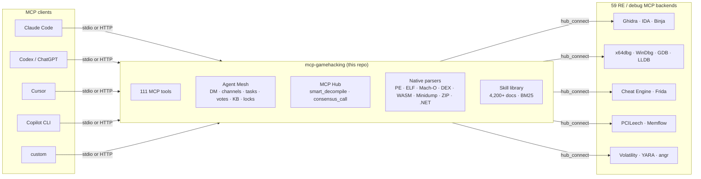

<div align="center">

# 🎮 mcp-gamehacking

### The MCP server that turns Claude, Codex, and Cursor into a reverse-engineering team.

**111 MCP tools · 59 RE/debug backends · 4,200+ skills · multi-agent mesh · zero-dep native parsers**

[](tests/) [](src/) [](src/retools.ts) [](skills/) [](Dockerfile) [](LICENSE) [](package.json)

[Quickstart](#30-second-quickstart) · [Architecture](docs/architecture.md) · [Comparison](#comparison) · [Agent Mesh](docs/agent-mesh.md) · [MCP Hub](docs/mcp-hub.md) · [Ethics](#ethics--responsible-use)

[English](README.md) · [Русский](README-ru.md) · [简体中文](README-zh.md)

</div>

---

## Why this exists

Reverse engineering a modern game involves five static tools (Ghidra, IDA, Binary Ninja, radare2, Hopper), three debuggers (x64dbg, WinDbg, GDB/LLDB), a hex-editor, a memory scanner (Cheat Engine), an instrumentation framework (Frida), and a stack of format parsers (PE, ELF, Mach-O, DEX, Minidump, Unity AssetBundle, UE `.pak`). Switching between them costs hours. Teaching a model to drive even one of them well costs more.

**This server:**

1. **Aggregates 59 existing RE / debug MCP backends** behind one connection — `smart_decompile` picks IDA when running, falls back to Ghidra, then Binja, then RetDec.
2. **Ships 111 native MCP tools** so most answers don't need an external backend at all — PE / ELF / Mach-O / DEX / WASM / Minidump / ZIP / .NET / IL2CPP metadata parsers, AoB signature scan, Shannon entropy, crypto-constant identification, PDB70 → Microsoft symbol server URL.
3. **Lets Claude, Codex, and Cursor collaborate** through a shared mesh — DM, channels, task handoff, adversarial voting, shared KV knowledge-base, named locks for coordination. Zero-dep JSON persistence.
4. **Curates 4,200+ skills** — 246 hand-written deep references on anti-cheat (BattlEye, EAC, Vanguard, VAC, FACEIT, Byfron, Ricochet, mhyprot) and 3,985 archived open-source projects with full source dumps.

If you're on security-research, cheat-detection, defensive-engineering, or game-SDK work — this collapses a day of tool-shuffling into one MCP connection.

## 30-second quickstart

[](https://codespaces.new/1llu50ry/mcp-gamehacking?quickstart=1)


```bash
# clone + build
git clone https://github.com/1llu50ry/mcp-gamehacking && cd mcp-gamehacking
npm install && npx tsc
npm test            # 20/20 should pass

# wire into Claude Code / Codex / Cursor (stdio mode)
# (add this JSON to your client's MCP config)
#   { "mcp-gamehacking": { "command": "node", "args": ["/path/to/dist/index.js"] } }

# OR run over HTTP (Docker-friendly)
docker compose up

# OR drive it from the CLI (no MCP client needed)
./bin/mcp-gamehacking.mjs stats
./bin/mcp-gamehacking.mjs search battleye
./bin/mcp-gamehacking.mjs tools    # list every registered MCP tool
```

Point your MCP client at it, then ask any of:

- *"Analyze `C:\game\binary.exe` and tell me what packer it uses."* → calls `analyze_binary` (entropy + Rich Header + Debug Directory + imports + crypto constants)
- *"Decompile `0x401000` using every connected backend and spot disagreements."* → `hub_consensus_call matcher=decompile`
- *"Alice, hand off driver.sys unpacking to Bob; Cursor review the result."* → mesh orchestration
- *"BM25 search 'battleye shellcode detection'."* → `bm25_search` ranks 4,230 docs by BM25 relevance

## Architecture



## Verticals

The game-hacking framing is historical — the tooling covers every RE discipline:

| Vertical | Why this project fits | Docs |
|---|---|---|
| 🎮 **Game security + anti-cheat** | 4,200+ hand-written skills across BattlEye, EAC, Vanguard, VAC, FACEIT, Byfron, Ricochet, mhyprot, Hyperion. | this README |
| 🦠 **Malware analysis** | PE / minidump / Rich Header / Debug Directory parsers + 59-backend hub (YARA, Volatility, angr, Qiling). | [docs/verticals/malware-analysis.md](docs/verticals/malware-analysis.md) |
| 📱 **Mobile security (iOS + Android)** | Mach-O (fat + arm64e) + DEX + APK parsers + Hopper + Frida + JADX + Magisk + idevice MCPs. | [docs/verticals/mobile-security.md](docs/verticals/mobile-security.md) |
| 🔧 **Firmware / IoT** | ELF + Qiling + Unicorn + angr for embedded. | [docs/verticals/firmware-iot.md](docs/verticals/firmware-iot.md) |
| 🏁 **CTF / exploit development** | pwndbg + GEF + angr + AFL++ + honggfuzz + LibAFL + Unicorn + ret-sync all behind one hub. | [docs/verticals/ctf-pwn.md](docs/verticals/ctf-pwn.md) |

## Comparison

| Project | Scope | Tools | Backends | Multi-agent | Skills archive |
|---|---|---:|---:|:---:|---:|
| **mcp-gamehacking** (this repo) | Game RE + anti-cheat + mesh orchestration | **111** | **59** | ✅ | **4,200+** |
| [GhidraMCP](https://github.com/LaurieWired/GhidraMCP) | Ghidra bridge | 5 | 1 | — | — |
| [ida-pro-mcp](https://github.com/mrexodia/ida-pro-mcp) | IDA bridge | ~50 | 1 | — | — |
| [SuperghidraMCP](https://github.com/yuatemycat/SuperGhidraMCP) | pyghidra | 38 | 1 | — | — |
| [REA](https://rea.tools) | Cross-stack RE (native + Electron + .NET) | ~40 | 3 | — | — |
| [Vibe-RE](https://github.com/wit-x/Vibe-Reverse-Engineering) | PE triage pipeline | ~30 | 1 | — | — |

## Ethics & responsible use

This project exists for **security research, cheat detection, defensive engineering, game-preservation, and reverse-engineering education**. Specifically:

- Anti-cheat engineers use it to understand bypass vectors and harden their systems.
- Red teams use it on binaries they are authorized to analyze.
- Students use it to learn how PE / ELF / IL2CPP / UE4 / Source2 actually work.
- Preservation groups use it to document archived game ecosystems.

**It is not a cheat.** It writes no code into any game. It automates no play. Use it against binaries you own or are authorized to analyze. Do not use it to grief, de-fraud, or harm other players.

Read [SECURITY.md](SECURITY.md) for responsible disclosure. By contributing you agree to [CODE_OF_CONDUCT.md](CODE_OF_CONDUCT.md).

---

## Features

### Skill Library

- **177 hand-written skills** -- deep technical references on injection, hooking, kernel drivers, anti-cheat internals, ESP/aimbot architecture, and more
- **3,985 archived projects** -- full source code snapshots from the game security ecosystem (prefixed `ags-`)
- Each skill has a `SKILL.md` (description, metadata, topics) and optionally a `source.txt` (complete source tree dump)

### Agents

| Agent | Description |
|-------|------------|
| `reverse-engineer` | Disassembly analysis, struct recovery, offset hunting, binary patching |
| `exploit-developer` | Kernel exploits, BYOVD chains, EFI persistence, privilege escalation |
| `anti-cheat-analyst` | BattlEye, EAC, Vanguard, VAC, FACEIT internals and bypass research |
| `malware-analyst` | Cheat binary analysis, unpacking, IOC extraction, technique classification |
| `cheat-developer` | ESP, aimbot, triggerbot, overlay rendering, UE/Unity/Source engine internals |
| `driver-developer` | WDM/KMDF drivers, IOCTL comm, memory R/W, stealth loading |
| `hypervisor-researcher` | Intel VMX, AMD SVM, EPT/NPT hooks, HV-based memory access |
| `android-researcher` | Zygisk, KernelSU, frida, IL2CPP dumping, native hooking |
| `network-analyst` | Game protocol RE, packet capture, MITM proxy, server emulation |
| `cs2-specialist` | Counter-Strike 2 / Source 2 internals |
| `valorant-specialist` | Valorant / UE4 fork / Vanguard interaction |
| `fortnite-specialist` | Fortnite / UE5 / EAC interaction |
| `apex-specialist` | Apex Legends / Source fork internals |
| `unreal-engine-specialist` | UE4/UE5 GObjects, GNames, ProcessEvent, SDK gen |
| `unity-specialist` | Unity Mono/IL2CPP, GameObjectManager, metadata |
| `source-engine-specialist` | Source 1/2 ConVar, NetVar, ClientClass |
| `injection-specialist` | All injection methods (manual map, reflective, APC, EFI) |
| `hooking-specialist` | All hook types (VMT, IAT, inline, EPT, syscall) |
| `obfuscation-analyst` | VMProtect, Themida, OLLVM analysis and unpacking |
| `windows-internals-agent` | EPROCESS, PEB/TEB, system calls, object manager |
| `ida-specialist` | IDA Pro scripting, plugins, FLIRT, type libraries |
| `ghidra-specialist` | Ghidra scripting, P-code, extensions |
| `dma-specialist` | DMA/FPGA memory access (PCILeech, Screamer) |
| ...and 52 more game-specific, engine-specific, technique-specific, and tool-specific agents |

### Subagents (161)

| Subagent | Purpose |
|----------|---------|
| `offset-finder` | Cross-reference game offsets across 3,900+ archived sources |
| `code-analyzer` | Classify technique, hook method, stealth measures |
| `pattern-scanner` | Generate and validate IDA-style byte patterns |
| `detection-assessor` | Assess detection risk per anti-cheat system |
| `vulnerability-scanner` | Find exploitable vulns in drivers and binaries |
| `struct-recovery` | Recover C++ structures from memory dumps or IDA |
| `binary-differ` | Diff game updates to track offset changes |
| `source-grep` | Deep search across all 3,985 source archives |
| `hook-planner` | Plan hook chains for specific objectives |
| `import-resolver` | Resolve imports for manual-mapped modules |
| `vtable-mapper` | Map virtual function tables |
| `syscall-stub-generator` | Generate direct/indirect syscall stubs |
| `bone-mapper` | Map skeleton bone indices per game |
| `ac-driver-analyzer` | Deep analysis of anti-cheat kernel driver |
| `stack-spoofer` | Spoof call stack for AC evasion |
| `shellcode-encoder` | Encode shellcode to evade signatures |
| ...and 145 more focused subagents across 16 categories |

### Plugins (114)

| Plugin | Purpose |
|--------|---------|
| `game-offset-db` | Cross-reference offset database for 60+ games |
| `technique-finder` | Find implementation examples across all source code |
| `yara-generator` | Generate YARA detection rules from cheat patterns |
| `driver-catalog` | Vulnerable driver database with exploit primitives |
| `hook-library` | All hook types with code examples and detection vectors |
| `struct-database` | Known game engine structures (UE4/UE5, Source, Unity) |
| `anti-cheat-timeline` | AC update tracking and bypass shelf-life |
| `exploit-chain-builder` | Compose multi-stage exploit chains |
| `signature-generator` | Generate and validate byte patterns |
| `cs2-offsets` / `valorant-offsets` / ... | Per-game offset databases (10 games) |
| `ue4-sdk-reference` / `ue5-sdk-reference` | Engine SDK structure references |
| `ntapi-reference` | Undocumented NT API reference |
| `syscall-table` | Windows syscall numbers per OS build |
| `battleye-detection-db` / `eac-detection-db` / ... | Per-AC detection databases |
| `offset-header-generator` / `hook-template-generator` | Code generation tools |
| ...and 99 more data, reference, and code generation plugins across 11 categories |

### Prompts (148)

| Prompt | Purpose |
|--------|---------|
| `analyze-cheat` | Full architecture analysis of a cheat project |
| `find-bypass` | Find bypass techniques for specific anti-cheat |
| `build-cheat` / `build-esp` / `build-aimbot` | Design cheat systems |
| `reverse-binary` / `reverse-unity-game` / `reverse-unreal-game` | RE workflows |
| `write-driver` / `write-injector` / `write-hook` | Implementation guides |
| `bypass-battleye` / `bypass-eac` / `bypass-vanguard` | AC bypass strategies |
| `spoof-hardware` | HWID spoofing design |
| `analyze-update` | Game update offset migration |
| `exploit-vuln-driver` / `exploit-kernel-bug` | Exploitation guides |
| `implement-backtrack` / `implement-autowall` / `implement-prediction` | Feature implementation |
| ...and 138 more prompts across 14 categories for every game hacking task |

---

## Tools (111 total)

### Workflow Tools

| Tool | Description |
|------|------------|
| `research_technique` | End-to-end technique research with scored keyword ranking |
| `analyze_project` | Full project analysis (SKILL.md + source code) |
| `get_agent_briefing` | Load agent definition with available subagents and plugins |

### Skill Tools

| Tool | Description |
|------|------------|
| `list_skills` | List/filter skills by name or type |
| `read_skill` | Read a skill SKILL.md |
| `read_source` | Read source code with pagination (50KB chunks) |
| `search_skills` | Multi-keyword scored search across names, descriptions, topics |
| `skill_stats` | Library statistics |

### Component Tools

| Tool | Description |
|------|------------|
| `list_agents` / `read_agent` | Browse and read agent definitions |
| `list_subagents` / `read_subagent` | Browse and read subagent definitions |
| `list_plugins` / `read_plugin` | Browse and read plugin definitions |
| `list_prompts` / `read_prompt` | Browse and read prompt templates |

### RE / Debug MCP Integrations (v4.1)

Launch and drive **43** external RE and debugging MCP servers directly from this server. Supported backends: **GhidraMCP, SuperghidraMCP (pyghidra-mcp, +gui), Ghidrathon MCP, ida-pro-mcp, Hex-Rays IDA MCP, Binary Ninja MCP, radare2 MCP, x64dbg MCP Server, WinDbg MCP, Cheat Engine MCP, Frida MCP, Hopper MCP, REA, Vibe-RE, JADX MCP, angr MCP, Capstone MCP, PCILeech/MemProcFS MCP, Memflow MCP, Scylla MCP, dnSpyEx MCP, ReClass.NET MCP, Volatility3 MCP, Wireshark/tshark MCP, mitmproxy MCP, dotPeek MCP, Unicorn MCP, ret-sync MCP, BinDiff MCP, Diaphora MCP, Qiling MCP, unidbg MCP, Reko (OpenReality) MCP, QEMU trace MCP, LLDB MCP, GDB MCP, Burp MCP, YARA MCP, ClrMD MCP, Binja-Ghidra sync MCP, Dolphin DME MCP, Cemu IPC MCP**.

| Tool | Description |
|------|------------|
| `list_re_backends` | List every known RE/debug MCP backend (filter by kind/os/tag) |
| `describe_re_backend` | Full detail for one backend (install, launch, HTTP endpoint, config snippet) |
| `pick_re_backend` | Recommend backend(s) for a described task |
| `re_mcp_config` | Emit a Claude Desktop / Claude Code / Cursor / Codex MCP config snippet |
| `launch_re_backend` | Spawn a backend as a managed child process |
| `stop_re_backend` | Terminate a backend (SIGTERM → SIGKILL after grace) |
| `re_backend_status` | Process status + recent stdout/stderr tail |
| `re_backend_health` | HTTP reachability probe for every backend that declares an endpoint |
| `re_http_call` | Proxy an HTTP request to a running backend |
| `x64dbg_cmd` | Send a command to a running x64dbg plugin (GetDebugState, SetBreakpoint, …) |
| `ghidra_decompile` | Decompile a function via a running pyghidra-mcp / superghidra-mcp |
| `cheat_engine_aob` | AoB (array-of-bytes) scan through a running Cheat Engine bridge |
| `frida_eval` | Evaluate a Frida JS snippet in a target process |
| `vibe_re_run` | Run a Vibe-RE Python module (`retools.disasm`, `retools.callgraph`, `livetools.analyze`, …) from vendored `tools/vendor/vibe-re` |
| `ida_run_script` | Run an IDAPython script headless via `idat64` |
| `ghidra_run_script` | Run a Ghidra script via `analyzeHeadless` |
| `install_re_backend` | Run the install commands from the catalog for one backend (with `dryRun` preview) |

### Native TypeScript RE Tools (always available)

Zero-dependency Node TypeScript. No Python, no Ghidra, no IDA needed.

| Tool | Description |
|------|------------|
| `pe_parse` | Parse PE/PE+ -- machine, bits, timestamp, sections (name/VA/size/entropy), imports (DLL + names), exports, overlay, Authenticode |
| `elf_parse` | Parse ELF (32/64, little-endian) -- machine, segments, sections, DT_NEEDED, SONAME, interpreter |
| `macho_parse` | Parse Mach-O (thin + fat) -- CPU, filetype, segments, load commands, LC_LOAD_DYLIB list |
| `dex_parse` | Parse Android DEX -- version, counts, first class names |
| `wasm_parse` | Parse WebAssembly -- version, section layout (standard + custom) |
| `file_identify` | Magic-byte sniff: PE, ELF, Mach-O (thin+fat), DEX, WASM, ZIP/APK/JAR, 7-Zip, gzip, zstd, LZ4, PDF, scripts, Switch NSO/NCA, Xbox 360 XEX, PS4/PS5 FSELF |
| `aob_scan` | IDA-style AoB signature scan over any file (`48 8B ?? ?? ?? ?? ?? E8`) |
| `entropy_scan` | Sliding-window Shannon entropy; flag windows above threshold (packed/encrypted detection) |
| `string_extract` | ASCII + UTF-16LE strings with minimum-length filter |
| `hash_identify` | Scan for MD5/SHA-1/SHA-256/CRC-32/FNV-1a/ChaCha20/Blowfish/AES crypto constants with byte offsets |
| `signature_make` | Make an IDA-style byte signature for a region of a file (with uniqueness check) |
| `file_summary` | Size, SHA-256, Shannon H, magic bytes, head/tail hex |

Vendored tool trees live under `tools/vendor/` (currently `vibe-re`, `ida-pro-mcp`). External backends install via `install_re_backend` or `describe_re_backend` → "Install" section. `tools/launchers/install-all.{ps1,sh}` bootstraps every pip/npm backend in one shot.

### Advanced Native Parsers

| Tool | Description |
|------|------------|
| `minidump_parse` | Parse Windows minidump (.dmp): streams, modules, threads, exception, system info |
| `pdb70_identify` | RSDS record -> GUID + age + PDB path + Microsoft symbol server URL |
| `rich_header_parse` | Rich header entries (MSVC build fingerprint) |
| `demangle` | MSVC + Itanium (GCC/Clang) C++ name demangler |
| `assetbundle_parse` | Unity AssetBundle header (UnityFS/Web/Raw/Archive) |
| `pak_parse` | UE4/UE5 .pak footer (magic 0x5A6F12E1, index offset+size+SHA1) |
| `il2cpp_metadata_parse` | Unity IL2CPP global-metadata.dat header (unencrypted) |
| `nso_parse` | Switch NSO header (segments + module id) |

### Workflow Tools

| Tool | Description |
|------|------------|
| `offset_diff` | Diff two offset JSON maps (added/removed/changed) |
| `offset_merge` | Merge N offset sources with voting quorum |
| `sig_validate_cross_build` | Check an AoB signature is unique across several builds |
| `ac_risk_report` | Risk matrix: technique × AC → tier (A/B/C/X) |
| `generate_cheat_sheet` | Markdown cheat sheet per game |

### Agent Mesh — multi-agent collaboration

Lets Claude Code, Codex/ChatGPT, Cursor, Copilot, Gemini CLI and custom bots share one workspace through MCP: register, DM + channel broadcast, task handoff with status machine, adversarial voting on findings, shared KV knowledge base, named locks. Persistence to JSON (zero npm deps). See [docs/agent-mesh.md](docs/agent-mesh.md).

Tools (15): `mesh_agent_register`, `mesh_agent_list`, `mesh_agent_heartbeat`, `mesh_send`, `mesh_read`, `mesh_task_create`, `mesh_task_update`, `mesh_task_list`, `mesh_task_vote`, `mesh_kb_set`, `mesh_kb_get`, `mesh_lock_acquire`, `mesh_lock_release`, `mesh_lock_list`, `mesh_stats`.

### MCP Hub — aggregate backend MCPs

Our server connects to other MCPs (ghidra, ida, x64dbg, binja, radare2, cheat-engine, frida, …) as a CLIENT and re-exposes their tools. Composable: `smart_decompile` picks the first available decompiler backend; `hub_consensus_call` fans out across backends for adversarial comparison. See [docs/mcp-hub.md](docs/mcp-hub.md).

Tools (6): `hub_connect`, `hub_list`, `hub_call`, `hub_disconnect`, `smart_decompile`, `hub_consensus_call`.

### CLI

```bash
mcp-gamehacking stats                 # library counts
mcp-gamehacking lookup battleye       # print SKILL.md
mcp-gamehacking search anti-cheat     # keyword search
mcp-gamehacking tools                 # list every MCP tool
mcp-gamehacking health [url]          # probe /healthz
mcp-gamehacking serve                 # start the MCP server
```

### Path sandbox (security)

File-reading tools (`pe_parse`, `elf_parse`, `aob_scan`, `zip_parse`, …) obey `MCP_FS_ALLOW` and `MCP_FS_DENY`. Default is open mode. Set `MCP_FS_ALLOW=/path/a,/path/b` to restrict reads when exposing the server over HTTP.

### HTTP transport, health, metrics

Set `MCP_TRANSPORT=http` to run the server over Streamable HTTP instead of stdio:

```bash
MCP_TRANSPORT=http MCP_HTTP_PORT=7777 MCP_HTTP_HOST=127.0.0.1 node dist/index.js
# → MCP endpoint:  POST http://127.0.0.1:7777/mcp
# → readiness:     GET  http://127.0.0.1:7777/healthz
# → Prometheus:    GET  http://127.0.0.1:7777/metrics
```

### Tests

```
npm test
```

Node's built-in test runner over `tests/*.test.mjs` (17 cases covering pattern parse, AoB scan, Shannon, string extraction, crypto-constant ID, signature make, PE parse, WASM parse, ELF rejection).

CI runs on push + PR (Node 18/20/22 matrix): [.github/workflows/ci.yml](.github/workflows/ci.yml).

---

## Installation

### Requirements

- Node.js 18+
- npm

### Build

```bash
cd mcp-gamehacking
npm install
npm run build
```

### Connect to Claude Code

Add to your MCP settings:

```json
{
  "mcpServers": {
    "gamehacking": {
      "command": "node",
      "args": ["/path/to/mcp-gamehacking/dist/index.js"]
    }
  }
}
```

### Connect to Claude Desktop

Add to `claude_desktop_config.json`:

```json
{
  "mcpServers": {
    "gamehacking": {
      "command": "node",
      "args": ["/path/to/mcp-gamehacking/dist/index.js"]
    }
  }
}
```

### Connect to Cursor

Add to `.cursor/mcp.json`:

```json
{
  "mcpServers": {
    "gamehacking": {
      "command": "node",
      "args": ["/path/to/mcp-gamehacking/dist/index.js"]
    }
  }
}
```

---

## Usage Examples

### Research a technique

```
> research_technique("EPT hook")

Found 12 relevant skills (showing top 10):
- ags-budget-ept (score:7) -- BudgetEPT: stealthy inline EPT-like hooks...
- ags-hyper-deceit (score:6) -- HyperDeceit: HvcallCodeVa hook framework...
```

### Analyze a project

```
> analyze_project("ags-kdmapper", focus="architecture")

# kdmapper
Most popular kernel driver mapper using iqvw64e.sys...
## Source Code (first 300 lines)
...
```

### Search skills

```
> search_skills("valorant vanguard bypass")

Found 23 skills:
- vgk-internals-callbacks (score:7)
- ags-valorant-external (score:4)
```

### Agent briefing

```
> get_agent_briefing("exploit-developer")

# Agent: exploit-developer
Kernel exploit and driver development agent...
## Available Subagents: offset-finder, detection-assessor
## Available Plugins: game-offset-db, technique-finder
```

---

## Project Structure

```
mcp-gamehacking/
+-- src/index.ts              # MCP server (16 tools)
+-- dist/                      # Compiled JS
+-- skills/                    # 4,161 skill directories
|   +-- <hand-written>/        #   177 curated deep-dive skills
|   +-- ags-*/                 #   3,985 archived projects
|       +-- SKILL.md           #     description + metadata
|       +-- source.txt         #     full source tree snapshot
+-- agents/                    # 75 agents across 7 categories
|   +-- games/        (15)     #   CS2, Valorant, Fortnite, Apex, etc.
|   +-- engines/      (10)     #   UE4/5, Unity, Source, CryEngine, etc.
|   +-- anti-cheat/   (10)     #   EAC, BE, Vanguard, FACEIT, Byfron, etc.
|   +-- kernel/       (10)     #   drivers, HV, firmware, DMA, EPT
|   +-- techniques/   (10)     #   injection, hooking, obfuscation, etc.
|   +-- tools/        (10)     #   IDA, Ghidra, WinDbg, Frida, x64dbg
|   +-- core/         (10)     #   RE, exploits, cheatdev, malware, etc.
+-- subagents/                 # 161 subagents across 16 categories
|   +-- offsets/      (10)     +-- patterns/     (10)
|   +-- code-analysis/(10)     +-- anti-cheat/   (11)
|   +-- kernel/       (10)     +-- injection/    (10)
|   +-- hooks/        (10)     +-- rendering/    (10)
|   +-- memory/       (10)     +-- network/      (10)
|   +-- game-data/    (10)     +-- stealth/      (10)
|   +-- reversing/    (10)     +-- platform/     (10)
|   +-- build/        (10)     +-- testing/      (10)
+-- plugins/                   # 114 plugins across 11 categories
|   +-- game-offsets/ (11)     +-- engine-sdks/  (10)
|   +-- anti-cheat/   (10)     +-- windows-int/  (10)
|   +-- technique-ref/(13)     +-- tool-finders/ (10)
|   +-- code-gen/     (10)     +-- binary-anal/  (10)
|   +-- crypto/       (10)     +-- detection/    (10)
|   +-- rendering/    (10)
+-- prompts/                   # 148 prompts across 14 categories
|   +-- build/        (11)     +-- write/        (16)
|   +-- implement/    (11)     +-- reverse/      (10)
|   +-- bypass/       (10)     +-- analyze/      (10)
|   +-- design/       (10)     +-- exploit/      (10)
|   +-- compare/      (10)     +-- debug/        (10)
|   +-- generate/     (10)     +-- migrate/      (10)
|   +-- optimize/     (10)     +-- setup/        (10)
+-- package.json
+-- tsconfig.json
```

---

## Skill Categories

### Hand-Written (177)

| Category | Examples |
|----------|---------|
| Kernel / Drivers | kernel-cr3-physmem, kernel-hooks-ssdt, vulnerable-driver-exploits |
| Injection | reflective-dll, pe-injection-remote, early-bird-apc, threadpool-wait |
| Anti-Cheat | vanguard (15+ vgk-* skills), battleye, eac, patchguard, hvci |
| Game Engines | unreal-object-model, source-netvars, world-to-screen, present-hook |
| Obfuscation | fix-vmp-themida-ollvm, control-flow-flattening, mixed-boolean-arithmetic |
| UEFI / EFI | efi-driver-bootkit, vgk-secure-boot-spoof |
| DMA | dma, iommu, iommu-state-verification |

### Archived Projects (3,985)

Sourced from [awesome-game-security](https://github.com/gmh5225/awesome-game-security):

- **60+ games**: CS2, Valorant, Fortnite, Apex, PUBG, Rust, R6, EFT, Overwatch, Genshin, etc.
- **Techniques**: injection, hooking, DMA/FPGA, driver comm, overlays, kernel exploits
- **Anti-cheat research**: BattlEye, EAC, Vanguard, VAC, FACEIT, Byfron
- **Tools**: IDA plugins, Ghidra scripts, debugger extensions, dumpers, unpackers
- **Platforms**: Windows kernel, Android (Zygisk/KernelSU/Magisk), iOS, Linux

---

## Tech Stack

- **Runtime**: Node.js 18+
- **Language**: TypeScript
- **Protocol**: MCP via `@modelcontextprotocol/sdk`
- **Transport**: stdio

---

## License

This project aggregates publicly available research materials and open-source project snapshots for educational and security research purposes.

---

# mcp-gamehacking (RU)

MCP-сервер для геймхакинга и реверс-инжиниринга. База знаний из **4,100+ скиллов** с полными архивами исходного кода, специализированными агентами и инструментами.

## Возможности

- **177 вручную написанных скиллов** -- инъекции, хуки, ядерные драйверы, внутренности античитов, архитектура ESP/аимбота
- **3,985 архивированных проектов** -- полные снимки исходного кода из экосистемы игровой безопасности
- **75 агентов** (7 категорий) -- по играм (CS2, Valorant, Fortnite, Apex...), движкам (UE, Unity, Source, CryEngine...), античитам (EAC, BE, Vanguard, FACEIT...), ядру (драйверы, HV, DMA, EPT), техникам (инъекции, хуки, обфускация), инструментам (IDA, Ghidra, WinDbg, Frida)
- **161 субагент** (16 категорий) -- поиск офсетов, анализ кода, паттерны, диффы бинарников, grep по 3985 архивам, планирование хуков, восстановление структур, аудит драйверов, стелс, рендеринг, сеть и ещё 145
- **114 плагинов** (11 категорий) -- базы офсетов по 10+ играм, справочники SDK, каталог уязвимых драйверов, детект-базы по каждому античиту, генераторы кода, анализаторы бинарников, крипто, рендеринг
- **148 промптов** (14 категорий) -- байпасс каждого античита, билд ESP/аимбота/триггера, реверс Unity/UE/Source игр, написание драйверов/инжекторов/оверлеев, эксплуатация, HWID спуф, миграция, оптимизация, дизайн
- **16 MCP-инструментов** -- воркфлоу-тулы, скиллы, компоненты

## Установка

```bash
npm install
npm run build
```

Добавьте в настройки MCP-клиента:

```json
{
  "mcpServers": {
    "gamehacking": {
      "command": "node",
      "args": ["/path/to/mcp-gamehacking/dist/index.js"]
    }
  }
}
```

## Категории скиллов

- **Ядро / Драйверы**: CR3, SSDT, уязвимые драйверы, BYOVD
- **Инъекции**: рефлективная DLL, manual map, APC, thread hijack
- **Античиты**: Vanguard, BattlEye, EAC, PatchGuard, HVCI
- **Игровые движки**: Unreal, Source, Unity -- офсеты, нетвары, w2s
- **Обфускация**: VMProtect, Themida, OLLVM -- распаковка и деобфускация
- **UEFI / EFI**: буткиты, EFI-маперы, спуф SecureBoot
- **DMA / FPGA**: прямой доступ к памяти, IOMMU
- **60+ игр**: CS2, Valorant, Fortnite, Apex, PUBG, Rust, R6, EFT и др.

## Лицензия

Проект агрегирует публично доступные исследовательские материалы и open-source проекты в образовательных целях и для исследований безопасности.