# Architecture

Four concentric rings. Everything downstream is strict addition over what's inside.

```mermaid
graph TB
    subgraph "MCP clients"
        CC[Claude Code]
        CX[Codex / ChatGPT]
        CS[Cursor]
        CP[Copilot CLI]
    end

    subgraph "Transports"
        STDIO[stdio]
        HTTP[streamable HTTP :7777/mcp]
        H[/healthz/]
        M[/metrics/]
    end

    subgraph "Server (src/)"
        direction LR
        subgraph "Native parsers (zero-dep)"
            NR[native-re<br/>PE/AoB/strings/entropy/hash/signature]
            NF[native-formats<br/>ELF/Mach-O/DEX/WASM]
            NA[native-advanced<br/>Minidump/PDB70/Rich/demangle/Unity/UE/NSO]
            NC[native-containers<br/>ZIP/APK/.NET/catalog]
            CT[composite-tools<br/>analyze_binary/pe_debug_dir/compare_binaries]
        end

        subgraph "Knowledge"
            IDX[in-memory skill index<br/>2 min TTL]
            BM25[BM25 search<br/>10 min TTL]
            RES[Dynamic resources<br/>gamehacking://.../]
        end

        subgraph "Workflow"
            WF[workflow-tools<br/>offset_diff/offset_merge/ac_risk_report]
            MT[meta-tools<br/>wiki_link_check/training_jsonl_export/symsrv_download/pattern_mine]
        end

        subgraph "Platform"
            FS[fs-sandbox<br/>MCP_FS_ALLOW]
            AR[audit-rate<br/>JSONL log + token bucket]
            AM[agent-mesh<br/>DM/channels/tasks/votes/KB/locks]
            HUB[mcp-hub<br/>hub_connect/hub_call/smart_decompile]
        end

        RE[retools<br/>59 RE/debug backend catalog + launcher]
    end

    subgraph "External MCP backends (optional)"
        G[Ghidra · SuperGhidra · Ghidrathon]
        I[IDA · ida-pro-mcp · Hex-Rays MCP]
        B[Binja · radare2 · RetDec · Snowman]
        D[x64dbg · WinDbg · GDB · LLDB · pwndbg · GEF]
        X[Cheat Engine · Frida · Hopper · REA]
        F[AFL++ · honggfuzz · LibAFL · WinAFL]
        P[PCILeech · Memflow · Volatility · YARA · angr · Unicorn · Qiling · unidbg]
        N[Wireshark · mitmproxy · Burp · CDP]
        R[Scylla · dnSpy · ReClass.NET · dotPeek]
    end

    CC & CX & CS & CP --> STDIO
    CC & CX & CS & CP -.-> HTTP
    HTTP --> H
    HTTP --> M

    STDIO --> IDX
    STDIO --> BM25
    STDIO --> AM
    STDIO --> HUB
    HTTP --> AM
    HTTP --> HUB

    NR -.calls.-> FS
    NF -.calls.-> FS
    NA -.calls.-> FS
    NC -.calls.-> FS
    CT -.calls.-> NR
    CT -.calls.-> NF
    CT -.calls.-> NA
    MT -.calls.-> FS

    HUB -->|MCP client| G & I & B & D & X & F & P & N & R

    RE -.catalog.-> G
    RE -.catalog.-> I
    RE -.catalog.-> B
    RE -.catalog.-> D
    RE -.catalog.-> X
```



## Modules

| File | What it registers |
|---|---|
| `src/index.ts` | Entry point. Creates `McpServer`, picks transport (stdio or streamable HTTP), wires every module. |
| `src/retools.ts` | 59-backend catalog + `list_re_backends` / `describe_re_backend` / `launch_re_backend` / `install_re_backend` / HTTP proxy / FakePDB / vibe-re. |
| `src/native-re.ts` | `pe_parse`, `aob_scan`, `entropy_scan`, `string_extract`, `hash_identify`, `signature_make`, `file_summary`. |
| `src/native-formats.ts` | `elf_parse`, `macho_parse`, `dex_parse`, `wasm_parse`, `file_identify`. |
| `src/native-advanced.ts` | `minidump_parse`, `pdb70_identify`, `rich_header_parse`, `demangle`, `assetbundle_parse`, `pak_parse`, `il2cpp_metadata_parse`, `nso_parse`. |
| `src/native-containers.ts` | `zip_parse`, `apk_scan`, `dotnet_parse`, `cat_sniff`. |
| `src/composite-tools.ts` | `analyze_binary`, `pe_debug_dir`, `compare_binaries`. |
| `src/bm25-search.ts` | `bm25_search`, `bm25_rebuild` (10-min TTL inverted index). |
| `src/workflow-tools.ts` | `offset_diff`, `offset_merge`, `sig_validate_cross_build`, `ac_risk_report`, `generate_cheat_sheet`. |
| `src/meta-tools.ts` | `wiki_link_check`, `training_jsonl_export`, `symsrv_download`, `pattern_mine`, `fs_sandbox_status`, `mesh_orchestrate`. |
| `src/agent-mesh.ts` | 15 tools for multi-agent collaboration. Persists `.agent-mesh/mesh.json`. |
| `src/mcp-hub.ts` | 6 tools making our server a CLIENT to other MCPs. |
| `src/fs-sandbox.ts` | `requirePathAllowed(path)` guard honoured by every file-reading tool. |
| `src/audit-rate.ts` | `audit_tail` / `audit_log` / `rate_limit_check` / `rate_limit_status`. |
| `src/dynamic-resources.ts` | `gamehacking://skills/{name}`, `gamehacking://plugins/{category}/{name}`, etc. |

## State

- **In-process:** skill index (2 min TTL), BM25 index (10 min TTL), HTTP transport sessions, hub-connected backends, mesh state.
- **On disk:** `.agent-mesh/mesh.json` (mesh), `.audit/audit.jsonl` (audit log), `.export/` (JSONL exports + symbol downloads), `.fakepdb-scripts/` + `.ghidra-projects/` (headless tool scratch).

## Transports

- `MCP_TRANSPORT=stdio` (default) — one process per client.
- `MCP_TRANSPORT=http` — streamable HTTP on `MCP_HTTP_PORT` (default 7777). Multiple clients share state. `/healthz` + `/metrics` exposed.

## Security surface

- `MCP_FS_ALLOW` / `MCP_FS_DENY` — path allowlist (default open; opt-in for HTTP deployments).
- `MCP_RATE_LIMIT=1` — enable token-bucket per `(tool, agent)`.
- `MCP_AUDIT_DIR` — path for the JSONL audit log.

## Testing

```bash
npm test   # 20+ node:test cases
```

- Native parser unit tests under `tests/native-re.test.mjs`, `tests/native-formats.test.mjs`.
- End-to-end mesh tests under `tests/agent-mesh.test.mjs` — spawn the server over stdio, go through init + register + send + task + vote + KB + lock.

## Deployment

- Local dev: `npm run dev` or `node dist/index.js`.
- Docker: `docker compose up` (multi-stage, non-root, dumb-init PID 1, healthcheck).
- CI: `.github/workflows/ci.yml` (Node 18/20/22 matrix + smoke).
- Release: push tag `v*` → `.github/workflows/release.yml` publishes to npm + `ghcr.io`.
