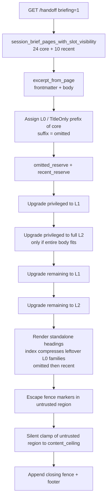
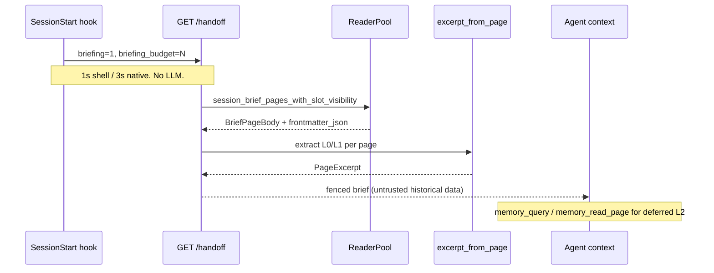

# Design: tiered L0/L1/L2 SessionStart brief

**Status:** Implemented in 3.1 by PR
[#1264](https://github.com/akitaonrails/ai-memory/pull/1264); this is the
design of record. The baseline, rollout, and PR-plan sections below describe
the proposal as reviewed, not unfinished work. Current behavior is summarized
in [`ARCHITECTURE.md`](ARCHITECTURE.md#data-flow).

This completed the remaining landscape R7 work: consume extractive L0/L1/L2
tiers on the opted-in SessionStart project brief. The proposal baseline was
verified against `main` at `dbe928e3` (`release: v3.0.0`).

Ideas only from OpenViking's progressive-disclosure tiers and Letta-code
MemFS directory deferral. Do not vendor either tree (OpenViking is AGPLv3).
No `viking://` URI scheme, no VLM sidecar, no TrieHI index, no on-disk
`MEMORY.md` convention.

---

## Problem

`render_session_brief` in `crates/ai-memory-hooks/src/router.rs` (around
line 2391) spends `[briefing] max_chars` (default 4000, clamp 1500-20000)
on full L2 bodies of up to 24 core pages (pinned / `_rules/` /
`_slots/`), then titles-only for up to 10 recent pages, then an omitted
suffix.

The packing is greedy and suffix-cutting. It writes each core page as
`## {title} (`{path}`)` plus `page.body.trim()`. The first body that does
not fit is truncated with `BRIEF_TRUNCATED_NOTICE` and every later core
page is omitted as a path pointer. One long `_rules/` page therefore eats
the budget; later standing pages become omitted pointers even when a
one-sentence abstract of each would have fit.

OpenViking's reported 34-91% input-token cut is almost entirely from
deferring full content. Letta-code MemFS v2 compiles root `*.md` every
turn and defers child directories behind index files. Landscape R7
(`docs/research-2026-landscape.md`, around lines 592-615) already named
this gap. 2.4 partly realized it by *persisting* extractive tiers for cold
episodic pages (A2 in `docs/design-memory-aging.md`). Remaining R7 is
*consuming* those tiers (and the same extractive fallbacks on never-compacted
pages) on the on-start brief.

This is a token-efficiency change on the hot path: every opted-in session
start, synchronously, inside the `GET /handoff` budget (shell hooks
`curl --max-time 1.0` in `hooks/_lib.sh`; native
`DEFAULT_HANDOFF_TIMEOUT` is 3s in
`crates/ai-memory-cli/src/commands/hook.rs`).

---

## What already exists (do not rebuild)

### SessionStart brief renderer

Verified in `crates/ai-memory-hooks/src/router.rs`:

- `BRIEF_BUDGET_DEFAULT = 4_000`, `BRIEF_BUDGET_MIN = 1_500`,
  `BRIEF_BUDGET_MAX = 20_000` (UTF-8 bytes, truncated on a code-point
  boundary via `truncate_at_char_boundary`; the marker key is named
  `max_chars`).
- `BRIEF_CORE_PAGES_LIMIT = 24`, `BRIEF_RECENT_PAGES_LIMIT = 10`.
- `render_requested_session_brief` (around 2051) runs only when the
  query flag `briefing` is truthy. It clamps `briefing_budget`, fetches
  via `session_brief_pages_with_slot_visibility`, and calls
  `render_session_brief`.
- Packing priority today, highest first: closing untrusted fence + agent
  footer (reserved via `brief_tail_len`) → security preamble +
  `UNTRUSTED_MEMORY_NOTICE` → full page bodies → omitted pointers →
  recent titles. A third of the variable region is reserved for pointer
  sections before bodies are packed, then given back if unused.
- Once one core page does not fit, every later one is omitted. The omitted
  set is always a suffix of `core`.
- Fence markers inside untrusted bodies are HTML-escaped
  (`escape_untrusted_history_tail`); escape only lengthens the text, so a
  final clamp of the untrusted region (never the preamble, never the
  closing fence) enforces the budget after escape.
- Tests: `render_session_brief_enforces_budget`,
  `render_session_brief_never_exceeds_budget`,
  `brief_budget_floor_clears_the_mandatory_scaffold` (around 16281). The
  floor must exceed the scaffold and still leave ≥500 bytes for page
  content. Recomputed `brief_scaffold_len` from the current constants is
  816 bytes (`BRIEF_PREAMBLE_TITLE` is 85 UTF-8 bytes: compass emoji
  U+1F9ED is four bytes; the title's U+2014 is three). Leftover at
  `BRIEF_BUDGET_MIN` is 684. Adding ` or `memory_read_page`` to the
  footer is 22 bytes (leftover 662), still ≥500. commit 4 re-measures from
  `brief_scaffold_len()` at that SHA.
- The security notice, both untrusted-history markers, and
  `BRIEF_AGENT_FOOTER` are budget-non-negotiable.

### Store fetch

`BriefPageBody` in `crates/ai-memory-store/src/reader.rs` (around 1720) is
`{path, title, body, pinned, updated_at}`. Full body only. No abstract,
summary, or frontmatter.

`session_brief_pages` / `session_brief_pages_with_slot_visibility`
(around 7703-7760):

```sql
SELECT path, title, body, pinned, updated_at
FROM pages
WHERE workspace_id = ?1 AND project_id = ?2 AND is_latest = 1
  AND not-expired
  AND (path GLOB '_rules/*'
       OR (pinned = 1 AND path NOT GLOB '_slots/*')
       OR slot-visibility-sql)
ORDER BY pinned DESC, path ASC
LIMIT ?3
```

Core is pinned (any path except the slot branch, which has its own
predicate), everything under `_rules/`, and visible `_slots/`. Unpinned
`gotchas/`, `decisions/`, and `procedures/` pages are not in this set
unless they are pinned. Recent rows are titles only, newest first,
slot-filtered, whole project.

Isolation: sibling projects never leak
(`session_brief_pages_selects_core_pages_and_isolates_projects` in
`crates/ai-memory-store/src/lib.rs`). Slot visibility:
`SlotVisibility::for_viewer` in `crates/ai-memory-core/src/slots.rs`,
applied in SQL (`slot_visibility.rs`).

`pages.body` is markdown excluding YAML frontmatter (`NewPage.body`
in `crates/ai-memory-core/src/page.rs`). Abstracts live in
`pages.frontmatter_json`. The current SELECT cannot see `abstract:` or
`summary:`.

Wiki writes auto-pin slots. `Wiki::write_page` does
`pinned = pinned || is_slot_path(&path)` (`wiki.rs` ~2683) and reindex
`IndexMetadata` ORs the same (`wiki.rs` ~2995-2999). Production `_slots/`
rows therefore sit in the `ORDER BY pinned DESC` prefix. Unpinned slots
exist in store-only fixtures (`sample_page` in
`session_brief_pages_selects_core_pages_and_isolates_projects` does not
go through that OR). The brief still treats `is_slot_path` as privileged
so a fixture or a raw upsert cannot lose a slot behind unpinned
`_rules/` L1/L2. Production SessionStart does not omit a slot behind
`_rules/` L0s unless 24 pinned pages already fill
`BRIEF_CORE_PAGES_LIMIT` (the pre-existing fetch cap).

### Extractive L0/L1 already in three places

They do not agree on clip size or prose granularity.

| Site | Order | Prose fallback | Clip |
|---|---|---|---|
| Profile digest `ProfileEntry::from_page` (`profile.rs` ~452-475) | `summary` then `abstract` then first prose **line** (then title) | `first_prose_line`: skips headings, `---`, ADR metadata fields | 240 **bytes**, ellipsis (`ENTRY_STATEMENT_MAX_BYTES`) |
| A2 compaction `summary_line` (`crates/ai-memory-consolidate/src/compaction.rs` ~68-91) | `summary` then `abstract` then first non-empty, non-heading **paragraph** | collapse whitespace | `MAX_SUMMARY_LEN = 500` bytes, ellipsis |
| V61 / wiki `frontmatter_abstract` (`wiki.rs` ~3099, duplicated in `embed.rs`) | `abstract` only | none | store cap `MAX_PAGE_ABSTRACT_LEN = 1024` (`page.rs` ~166) |

A2 compact (`build_compacted_markdown`): keeps the L0 `abstract:`
frontmatter untouched, writes an L1 summary line at the top of the new
body, mines regex keep-tokens as L2 identifiers, drops trailing prose,
sets `compacted: true`. V65 `pages.compacted_at` is derived at the
upsert choke point (`ops.rs` ~1719-1729) from that frontmatter mirror.
Opt-in via `[decay] compact_cold_episodic` (default false). Reversible
through supersession / `restore-page`.

Reuse the profile order for L1 and the A2 500-byte paragraph clip as
the brief's L1 budget. OpenViking's L1 overview of 4000 characters is
this project's entire default brief, so it is too large for a per-page
L1 here.

### Marker and once-per-session gate

`.ai-memory.toml`:

```toml
[briefing]
inject_on_session_start = true
max_chars = 4000
```

Opt-in, off when absent (`HandoffQuery.briefing`, forwarded by
`marker_query_suffix_impl_from_selection` in
`crates/ai-memory-cli/src/commands/hook_capture.rs` ~650-720). Truthiness
and the clamp are server-side. `inject_on_session_start` and `max_chars`
are already in the marker boundary key list (`marker.rs`
`declares_more_than_capture`).

Once-per-session is a client gate: Claude-class SessionStart injects
once; Kimi (SessionStart stdout discarded) sends `&briefing=` only on
the first user-prompt (`hook.rs` ~1072-1130, `briefed/<key>` sentinel).
The server recomposes whenever the flag is truthy. `/clear` re-briefs on
Claude; Kimi v1 does not; this design does not change that.

### Other surfaces that look like L0/L2

- `memory_query` snippets: FTS5 `snippet(..., 24)` (~24 words). Landscape
  called this L0. That snippet is a search-hit window around matched
  terms. The page abstract lives in frontmatter.
- `memory_read_page`: full body (L2), optional `include_related`.
- `memory_briefing`: structured JSON snapshot (counts, `rules`/`slots`/
  `recent` titles, opt-in `pinned` list of 10, opt-in `settled_first`).
  Empty `pinned` omitted; `settled_first` default off. Different code
  path from `render_session_brief`. Keep its JSON shape unchanged in v1.
- `memory_explore`: LLM prose over that snapshot; degrades to JSON with
  no provider. Do not put the SessionStart brief on this path.
- MCP tools: frozen at 23 (`MCP_TOOL_NAMES` in
  `crates/ai-memory-mcp/src/server.rs` ~7940). Footer already tells the
  agent to call `memory_query` for detail.

### What R7 already spent

A2 persisted the L0/L1/L2 *shape* for cold episodic pages. V61
`page_abstract_embeddings` plus `[retrieval] abstract_vectors` (default
off) is a retrieval-ranking stream over `abstract:` text. Neither is a
SessionStart brief. Abstract embeddings are not required for this work.

Latest migration on disk is V76. A new table would be V77 and
backup-gated. This design adds none.

---

## Invariants this design must hold

Restated from `AGENTS.md` because they bound the packing:

1. **One config-read path (#1).** Marker `[briefing]` is forwarded on the
   request. Server clamps with the existing constants. No new env re-read
   inside the renderer.
2. **Hooks bounded (#5).** `POST /hook` stays fire-and-forget (≤200 ms
   script timeout, 202/429). The brief is compiled on `GET /handoff`,
   which is already a synchronous SessionStart read (1s shell / 3s
   native). Keep it cheap: no LLM, no extra network, no VLM, no new
   SQL table, same 24-body fetch. Extraction is string ops on memory the
   fetch already returns.
3. **Sanitizer is the only ingress (#6).** Brief output is untrusted
   historical data. The security notice, both fence markers, the escape
   pass, and the footer stay budget-non-negotiable. Retrieved memory is
   never instructions.
4. **Zero-LLM default (#13).** Capture, search, and this brief work with
   no provider. Extractive L0/L1 only.
5. **Pages shared, batons owned (#16).** The brief does not filter pages
   by `author_id`. Slot visibility stays the existing
   `SlotVisibility::for_viewer` SQL predicate.
6. **MCP tool count was frozen at 23 for this proposal.** No `memory_brief_expand`. Footer
   already points at follow-up tools.
7. **Wiki mutations stay on `Wiki::write_page` / `apply_batch`.** This
   design does not write wiki files. It only reads latest rows.

---

## Goals and non-goals

### Goals

- More standing pages in the same `max_chars`, fewer omitted `_rules/`
  and pinned pages, still zero-LLM.
- Lead with per-page L0 (and L1 where it fits); expand to L2 bodies only
  while budget remains, with a defined privileged set that gets depth
  first.
- One extractive helper so the brief, the profile digest's frontmatter
  order, and A2's L1 clip stay consistent.
- Directory-index *presentation* for crowded unprivileged families,
  renderer-only.
- Rollback by reverting the renderer. No data migration.

### Non-goals

- A new MCP tool, or any change that moves `MCP_TOOL_NAMES.len()` off 23.
- `memory_query detail=` / `path_prefix=` SQL LIKE (OpenViking TrieHI
  half of R7). Follow-up after this lands. The last section of this
  design is a pointer, with no query schema.
- Generating L0/L1 with an LLM or VLM sidecar.
- Vendoring OpenViking or Letta code; `viking://` URIs; TrieHI; a VLM.
- Changing `memory_briefing` JSON in v1 (empty `pinned` omitted,
  `settled_first` default off).
- memU procedure-evolve, Hindsight `is_stale` / delta, Graphiti
  window-close.
- Raising `MAX_PAGE_ABSTRACT_LEN` (1024) or `BRIEF_CORE_PAGES_LIMIT`
  (24).
- A new on-disk `MEMORY.md` / `.abstract.md` / `.overview.md` convention.
- Expanding the core fetch to unpinned `gotchas/` / `decisions/` /
  `procedures/` in v1.
- Version bump / release tag.

---

## Key Decisions

1. **L0/L1 extractive source and clips.** L0: frontmatter `abstract:` if
   nonempty, else `summary:` if nonempty, else the leading prose,
   clipped to **256 UTF-8 bytes** with `truncate_utf8_bytes` (ellipsis
   inside the cap). L1: `summary:` then `abstract:` then the leading
   prose, clipped to **500 UTF-8 bytes**, matching A2
   `MAX_SUMMARY_LEN`. Do not raise `MAX_PAGE_ABSTRACT_LEN`. Brief-side
   clip only. L2: current `pages.body` (already frontmatter-stripped).
   Rationale: OpenViking L0 is the abstract; the operator `summary:` is
   the natural fallback when `abstract:` is missing. Putting the first
   paragraph ahead of `summary:` would make L0 worse than L1 on pages
   the operator already summarized. Our stored abstract may be 1024,
   which would spend the whole default brief on four pages. OpenViking
   L1 of 4000 is our entire default budget. A short summary used for
   both L0 and L1 is a zero-delta upgrade (no-op).

2. **Privileged for L2 promotion.** A page is privileged when
   `pinned == true` or `is_slot_path(path)` (`_slots/…`). Unpinned
   `_rules/` pages are coverage-first: they all get L0 before anyone
   other than the privileged set takes L1/L2. Rationale: pin is the
   operator's depth signal; slots are standing hot-context by
   construction (and wiki writes auto-pin them). Unpinned `_rules/` are
   the pages that starve each other today. `is_slot_path` stays in the
   predicate as defence in depth for store-only fixtures.

3. **Directory indexes are render-only compression.** No new wiki file.
   Assignment costs **standalone** `## {title} (`{path}`)` headings plus
   tier text. After all five assignment steps, if ≥4 unprivileged
   included pages in the same first path segment of `{_rules, gotchas,
   decisions, procedures}` remain at L0, render them as one compact
   `path + L0` list. Do not re-promote from those savings (no fixpoint).
   Leftover bytes go to the omitted helper, then recent. In v1 the only
   crowded family that actually appears unprivileged is `_rules/`.
   Privileged and L1/L2 siblings keep their own headings at their
   store-order positions.

4. **`BriefPageBody` grows the raw materials the helper needs.** Add
   `frontmatter_json: serde_json::Value`. The renderer calls a core
   helper. The store stays a fetch. Rationale: extraction has to live in
   one place; `ai-memory-store` should not own clip policy. An earlier
   draft also carried a `compacted` flag; nothing in packing reads it,
   so it is not fetched.

5. **Tiering is on whenever briefing is on.** No `[briefing] tiered`
   flag. Briefing is already the opt-in for spending tokens on every
   session start. Small wikis still get full bodies: privileged L2
   promotion fills the budget when few pages compete. Pin and
   `max_chars` remain the depth knobs. The marker-file and cookbook
   sentences that today promise L2-first ship in the same commit as the
   packer (see commit 4).

6. **No new MCP tool.** Extend `BRIEF_AGENT_FOOTER` to name
   `memory_read_page` beside `memory_query`. Point omitted headers at
   `memory_read_page` (the caller already has the path). Keep
   `memory_query` on the recent/search chrome. Follow-up cues stay in
   trusted chrome (preamble, notice, footer, omitted/recent headers).
   Directory-index headings carry no tool instruction. Tool count stays
   23.

7. **No schema migration.** Frontmatter plus body already hold the text.
   V61 embeddings are for ranking. A2 already persisted compacted bodies
   in git. Latest migration is V76; we do not need V77.

8. **Semver: minor (3.1).** CHANGELOG `### Changed` (the opted-in
   brief packs differently). The work targets `release/3.1`, the
   standing branch for the next minor.

9. **Omitted standing-rule pointers stay reserved after the L0 pass.**
   Today's renderer gives omitted first call because a crowded-out
   `_rules/` page is a standing rule the agent did not receive. L0-first
   still omits a suffix at max clip (heading plus 256-byte L0 is
   ~330-360 bytes; a 4000-byte brief holds on the order of 8-9 max-size
   L0s of 24 fetched pages). After the L0 pass, reserve the omitted
   section for that suffix, at least the count-only line, before any
   L1/L2 promotion. Promotions must not eat the omitted section down to
   nothing. Named formulas (`recent_cap`, `count_only_floor`,
   `remaining`) live in §3.

10. **Title-only pages render as a path line.** Empty body and empty
    frontmatter: a single `- `{path}`` line, the same grammar as the
    omitted list. Cost that line. Reject a blank `##` heading. The page
    counts as already at max depth, so it does not block L2 of siblings.

---

## Proposed design

### 1. Extractive helper in `ai-memory-core`

New module `crates/ai-memory-core/src/excerpt.rs`, IO-free, exported
from `lib.rs`. Same frontmatter keys and prose skip list as the profile
digest, with brief-specific clips.

```rust
pub const BRIEF_L0_MAX_BYTES: usize = 256;
pub const BRIEF_L1_MAX_BYTES: usize = 500; // A2 MAX_SUMMARY_LEN

pub struct PageExcerpt {
    pub l0: Option<String>,
    pub l1: Option<String>,
}

pub fn excerpt_from_page(
    frontmatter: &serde_json::Value,
    body: &str,
) -> PageExcerpt { /* … */ }

pub fn leading_prose(body: &str) -> Option<String> { /* … */ }

pub fn frontmatter_nonempty<'a>(
    frontmatter: &'a serde_json::Value,
    key: &str,
) -> Option<&'a str> { /* trim, reject empty */ }
```

**L0:** `abstract` if nonempty, else `summary` if nonempty, else
`leading_prose(body)`. Clip with `truncate_utf8_bytes(..., 256)`.

**L1:** `summary` if nonempty, else `abstract` if nonempty, else
`leading_prose(body)`. Clip with `truncate_utf8_bytes(..., 500)`.

`leading_prose` walks every `\n\n` block, like A2 `summary_line`
(`compaction.rs` ~79-89), and keeps reading across blocks until it has
more than the L1 clip can carry. It skips every line that is a `#`
heading, a lone `---`, or `is_metadata_field` (already `pub` in
`profile.rs`; call it, do not relocate `ADR_METADATA_LABELS`), wherever
it sits, and collapses the rest the way A2 already does
(`split_whitespace` joined by spaces). `# Title\n\nUse nextest.` yields
`Use nextest.`. An earlier draft stopped at the first paragraph; the
risk review found rules pages that open with a sentence about
themselves ("This page collects the security rules.") and lost every
rule after it, so the walk reads on into lists.

Also skip a block whose trimmed text starts with
`_Extractively compacted from a cold episodic page` (the A2 footer
prefix) and continue. Do not import `COMPACTION_FOOTER` into
`ai-memory-core`. A compacted body that is only that footer then has no
prose and falls through to title-only.

Required walker tests (all with empty frontmatter so L0/L1 come from
the body):

- `# Title\n\nUse nextest.` → L0 and L1 are `Use nextest.`
- The ADR template in `profile.rs` ~1066-1072 (`# Title`, status field
  with the HTML comment, `## Context`, then `Readers blocked the writer
  under load.`) → L0/L1 are `Readers blocked the writer under load.`
- No-blank-line ADR: `**Status:** Accepted` and the decision sentence
  in one `\n\n` block → L0/L1 are the decision.

Empty abstract/summary must not produce a blank `Some("")`. Whitespace-
only is absent.

**Do not change profile digest output in the helper PR.**
`ProfileEntry::from_page` may call `frontmatter_nonempty` for the
`summary` then `abstract` lookup and keep `first_prose_line` plus the
240-byte clip. The digest is a one-line statement; the brief is a
paragraph. Sharing the key order is the contract. Switching the digest
to paragraphs would change every profile SessionStart and is out of
scope.

**A2 compaction** may switch `summary_line` to `excerpt_from_page().l1`
in a later PR if the suite stays green. Do not block the brief on that
migration. A2 already matches L1 order and the 500-byte clip. The
brief walker also skips ADR metadata lines and continues when a
block's remainder is empty.

**Compacted pages.** `excerpt_from_page` takes only frontmatter and
body, so a compacted page needs no flag for nonempty L0/L1. A2 left `abstract:` in
frontmatter and put the L1 line at the top of the body, then
keep-tokens, then `COMPACTION_FOOTER`. Typical result: L0 from abstract
(or summary, or the L1 line clipped to 256), L1 from
summary/abstract/leading prose (the A2 line, then the retained facts),
L2 the whole compacted
body including keep-tokens. Promoting to L2 is how keep-tokens reach
the agent. Never treat a compacted page as "skip extraction" (that is
how a page becomes an empty section).

If L0 and L1 would be identical strings, both fields may hold that
string; the packer treats a zero-delta upgrade as a no-op. Same for L1
versus L2 when the body is already ≤500 bytes (short rules, compacted
pages with no keep-token tail).

### 2. Store fetch

Extend the core SELECT:

```sql
SELECT path, title, body, pinned, updated_at, frontmatter_json
```

Parse `frontmatter_json` to `serde_json::Value`; on parse failure use `{}`
(body-only excerpts). Every write serializes the column through
`serde_json`, and the recent-pages query already runs `json_extract`
over it, so a corrupt row is not a new failure mode of this fetch.

Keep limits, order, expiry, slot SQL, and project isolation. Limits stay
24 / 10. Do not fetch `page_abstract_embeddings`.

`BriefPageBody` remains in-process (the `Serialize` derive is unused on
the wire). Adding fields does not change `memory_briefing` JSON
(`BriefingPage` / `BriefingSnapshot` are the snapshot types).

commit 3 lands the fields and the SELECT while the renderer still reads only
`path`, `title`, `body`, `pinned`. Existing brief tests stay
byte-identical until commit 4.

### 3. Packing algorithm

Replace the stream-into-buf L2 loop. Assign a tier per core page, then
render once.

Tiers: `Omitted | TitleOnly | L0 | L1 | L2`.

**Cost model (authoritative).** Assignment costs **standalone** headings
plus tier text against the budget. Each included L0/L1/L2 page is costed
as:

```text
\n## {title}{pin} (`{path}`)\n{tier text}\n
```

Title-only pages cost a single `- `{path}`` line. The directory index
is not in this cost model. `rendered_len` used during assignment
therefore over-approximates when an index will later compress a family:
it never assumes an index, so a later render cannot exceed the budget
because a promotion dissolved a group. Index savings are leftover bytes
and are not spent on further promotions (no fixpoint). After
assignment, leftover goes to `render_brief_omitted_section`, then
`render_brief_recent_section`.

Fence escape remains the one unpredictable growth; the existing
post-escape clamp handles it. `rendered_len` is pre-escape.

**Reserves.** Named quantities, computed from the existing helpers.

```text
prefix_len = BRIEF_PREAMBLE_TITLE.len()
           + BRIEF_PREAMBLE_BOUNDARY.len()
           + UNTRUSTED_MEMORY_NOTICE.len()
           + "\n\n".len()
           + UNTRUSTED_HISTORY_START.len()
           + 1
           // 475 at dbe928e3; equals brief_scaffold_len() - brief_tail_len()

content_ceiling  = budget.saturating_sub(brief_tail_len())
variable_region  = content_ceiling.saturating_sub(prefix_len)

recent_full      = render_brief_recent_section(recent, usize::MAX).len()
recent_cap       = min(recent_full, variable_region / 4)

count_only_line(n) = format!(
    "\n**{n} core page(s) omitted by budget** (read via `memory_read_page`)\n"
)
count_only_floor = count_only_line(core.len()).len()
                 // The L0 pass does not yet know the suffix length; core.len()
                 // bounds it, so this is the most digits the line can need.
                 // 0 when core is empty.

l0_spent     = prefix_len + sum of standalone costs of assigned pages
remaining    = content_ceiling.saturating_sub(l0_spent)
full_omitted = render_brief_omitted_section(suffix, usize::MAX).len()

omitted_reserve =
    0                          if suffix is empty
    min(full_omitted, remaining / 4)
      .max(count_only_line(suffix.len()).len())
      .min(remaining)          otherwise

recent_reserve = min(recent_full, remaining.saturating_sub(omitted_reserve) / 4)
```

Closing fence + footer stay first (`content_ceiling`). `recent_cap` is
the L0-pass hold-back (full variable region / 4). `recent_reserve` is
the post-L0 value (leftover after the omitted floor / 4). L1/L2
promotions compete only against
`content_ceiling - omitted_reserve - recent_reserve - l0_spent`.

At render, omitted is given the leftover minus `recent_reserve` (it may
grow from count-only to a path list if promotions left room), then
recent takes what omitted did not use. That keeps today's "omitted has
first call" policy after coverage without eating the recent share.

**Assignment, in order.**

1. **L0 coverage.** Walk `core` in store order (`pinned DESC, path ASC`).
   For each page, compute L0 text. If `l0` is `None`, the candidate is
   a TitleOnly path line. A non-empty body that costs less than its L0
   (a frontmatter `abstract:` or `summary:` can be longer than the body
   it describes) is covered at L2 instead, at its own cost (#1360).
   Greedy-fit against
   `l0_ceiling = content_ceiling - recent_cap - count_only_floor`
   (a candidate fits when `l0_spent + cost(candidate) <= l0_ceiling`).
   If the candidate does not fit, stop. Every later page is `Omitted`.
   The omitted set remains a well-defined **suffix of `core`**, now at
   L0 granularity.

   Then compute `remaining`, `omitted_reserve`, and `recent_reserve`
   from the formulas above. If the suffix is empty, `omitted_reserve`
   is 0 and the unused `count_only_floor` sits in `remaining` for
   promotions.

   No walk-back is needed. The coverage ceiling already holds back
   `recent_cap + count_only_floor`, so after the pass `remaining` is at
   least the count-only line for any suffix, and `omitted_reserve` plus
   `recent_reserve` never exceed `remaining` by construction.
2. **Privileged L1.** For included privileged pages, in order: upgrade
   L0→L1 when `l1` is longer than `l0` and the delta fits in the
   post-reserve remainder.
3. **Privileged L2.** For included privileged pages, in order: upgrade
   to full `body.trim()` only when the *entire* L2 fits. Do not
   truncate an L2 in this pass. Truncation of one body is what starves
   later pages today. If L2 does not fit, the page stays at L1. A body
   cheaper than the L1 the page shows always fits: the swap is free and
   its saving returns to the remainder. This holds in (5) and (6) too.
4. **Unprivileged L1.** Same as (2) for the remaining included pages.
5. **Short bodies.** In store order, complete any unprivileged page whose
   whole body is at most `SHORT_BODY_SLACK` (128) bytes more than what it
   already shows. This runs before the gate in (6), so one page whose L1
   did not fit cannot hold back bodies that cost about a heading.
6. **Unprivileged L2.** Same as (3), only after every included page is
   at its max useful depth: L1 (or L0 when L1 is a zero-delta no-op),
   or TitleOnly. Title-only and zero-delta pages count as already at
   max depth. They do not block L2 of siblings. Pages go cheapest delta
   first (store order breaks ties), so the room left shows as many
   whole pages as it can.

The risk review (old vs new renderer on the same fixtures) measured the
trade-off this ordering makes: with 24 rules of 300-800 bytes at 8000
bytes, the old renderer showed 12 whole bodies and omitted 11 pages; the
coverage-first packer shows all 24, and fewer of them whole. Steps 5
and 6 recover whole bodies only from bytes coverage did not need; they
never take a page out of the brief to make room for another's body.

**No L2 truncation during assignment.** The only remaining cut of page
text is (a) the L0/L1 clips themselves, (b) the post-escape clamp on the
untrusted region, identical to today: a silent
`truncate_at_char_boundary` with **no** notice. Today's
`BRIEF_TRUNCATED_NOTICE` is emitted only in the in-loop L2 truncation
path (`router.rs` ~2447-2454). That path goes away, so delete the
constant in the packer PR (or `#[allow(dead_code)]` only if a same-PR
cleanup would enlarge the diff). Do not hang the notice on the clamp:
the clamp must never eat the closing fence, and the current clamp is
silent. Rewrite `render_session_brief_enforces_budget` so a 2000-byte
first body at `BRIEF_BUDGET_MIN` is an L0 and later `_rules/` pages
appear at L0; drop the `[truncated by `[briefing] max_chars`]`
assertion.

**Empty project.** `core.is_empty() && recent.is_empty()` still returns
`None` (inject nothing).

Worked example at the default 4000-byte budget, 816-byte scaffold,
`variable_region` 3184, `count_only_floor` 69, `recent_cap` =
`min(recent_full, 796)`:

- Today: one 3500-byte `_rules/architecture.md` is truncated;
  `_rules/testing.md` is omitted.
- Tiered, short abstracts: 12 `_rules/` pages with 80-byte abstracts
  fit at L0 (~150 bytes each with heading ≈ 1800 bytes). A pinned
  `_slots/focus.md` of 400 bytes upgrades to L2. Two pinned ADRs
  upgrade to L1 (500). Leftover may promote one unpinned rule to L1.
  Twelve standing pages in context from the same 4000-byte budget.
- Tiered, max L0: 24 `_rules/` pages with 256-byte L0s. About 8-9 fit
  as standalone L0; the suffix is omitted. The omitted section still
  emits at least the count-only line. L1/L2 promotions, if any, run
  only in bytes above that floor.

At `BRIEF_BUDGET_MIN` (1500, 684 leftover after scaffold; 662 after the
footer gains `memory_read_page`): a handful of L0s still beat one
truncated L2. The floor test stays: scaffold plus ≥500 bytes of page
room.

**Directory-index example (costing vs render).** Five unprivileged
`_rules/` pages, path order `a.md` … `e.md`. Assignment costs five
standalone H2+L0 blocks. One (`b.md`) promotes to L1; four stay L0.
Render walk in store order:

- `a.md` is the first index member of `_rules/` (four L0 siblings):
  emit the whole `### `_rules/`` group (`a`, `c`, `d`, `e` as
  `- `{path}`: {l0}`).
- `b.md` is L1: keep its `##` heading at this store-order position.
- `c.md` / `d.md` / `e.md`: skip, already in the group.

Index savings are leftover for omitted then recent. Do not promote a
fifth page from those savings.

### 4. Render shape

Keep the preamble, security notice, fences, and footer. Inside the
untrusted region:

**Heading for L1/L2 (and for L0 pages that are not in an index):**

```markdown
## {title}{pin} (`{path}`)
{tier text}
```

`{pin}` is ` 📌` when `pinned`, as today. No `L0`/`L1`/`L2` labels in
the injected text (those names are maintainer vocabulary). The footer
is the follow-up cue.

**Title-only** (empty body, empty frontmatter, no extractable L0):

```markdown
- `{path}`
```

Same bullet grammar as the omitted list. Never `## {title}` with a
blank following line.

**Directory index** (unprivileged, same family, ≥4 members, all still
L0, applied after assignment):

```markdown
### `{family}/`
- `{path}`: {l0}
- `{path}`: {l0}
```

No tool name in this heading. Follow-up lives in the footer, outside
the untrusted fence. Preamble, notice, omitted/recent headers, and
footer are trusted chrome; mixing a tool cue into the untrusted region
next to page abstracts would teach agents to treat that region as
system text.

Emit the group once, at the position of its first L0 member in store
order. Skip later L0 members of that group. Privileged and L1/L2
siblings keep standalone headings at their store-order positions and
are not listed in the index. Threshold 4: three short rules as
ordinary L0 headings are readable; a dozen `_rules/` H2s waste heading
bytes.

**Omitted section.** Same helper, same degradation (full path list →
partial + remainder → count-only). Paths only. Change both the full
header (`BRIEF_OMITTED_HEADER`) and the count-only variant from
`memory_query` to `memory_read_page`: omitted pages are exactly the
ones whose path is already known. Keep a nonempty omitted section
whenever the suffix is nonempty and the reserved floor fits (the
count-only line). Do not degrade to an empty string while that floor
was reserved. Attaching L0 abstracts to omitted rows would cost the
same as including them.

**Recent section.** Unchanged header (`memory_query` is the right
follow-up for "titles you may search").

**Footer.** Change the last clause to:

```text
call `memory_query` or `memory_read_page` for detail beyond this brief.
```

`memory_query` remains the search path (L0 snippets). `memory_read_page`
is the L2 path for a deferred body. Re-measure `brief_scaffold_len` so
`BRIEF_BUDGET_MIN` still clears the floor with ≥500 bytes of page room.
The extra 22 bytes leave 662, still ≥500.

**Escape and clamp.** Unchanged: `escape_untrusted_history_tail` from
`history_start`, then if `buf.len() > content_ceiling` truncate the
untrusted region on a char boundary, then append the closing fence and
footer.





### 5. Default behavior and rollout

Tiering runs for every request that already opted into briefing. No new
marker key. Operators who want the old "dump L2 until it breaks" shape
pin the pages that must appear in full and raise `max_chars` (still
clamped to 20000). That is the same knob they have now; it starts
working for more pages.

CHANGELOG bucket: `### Changed` under `[Unreleased]`. This is a
user-visible change to an existing opt-in. Semver: minor, additive
rendering for the 3.1 line. Patches stay on `main`.

Rollback: revert the renderer (and, if needed, the extra SELECT
columns). Wiki and SQLite rows are untouched. Compacted A2 pages stay
valid either way.

Feature flag: none. Briefing itself is the flag.

### 6. Latency and load

- Fetch: one existing read-pool query, 24 bodies plus a JSON column
  already on the row. No extra round-trip.
- CPU: extract + pack over ≤24 pages, each body already in memory for
  L2. Target: well under 50 ms added, so the whole `GET /handoff`
  (handoff + brief + profile digest) stays inside the 1s shell budget.
  The work per page is bounded by the budget, not by the page: the prose
  walk reads at most the first 16 KiB and stops one byte past the L1
  clip, sections are priced arithmetically, and a body longer than
  `BRIEF_BUDGET_MAX` (which can never fit whole) is neither escaped nor
  copied. An isolated stress run (200 concurrent briefs over 24 core
  pages of 200 KB, debug build) caught an earlier version at p50 4.9 s;
  with these bounds it matches the pre-change renderer (p50 ~0.37 s,
  p99 ~0.58 s, dominated by the fetch). Two complexity tests pin it.
- Storage: zero new bytes on disk.
- Tokens: default 4000 bytes remains ~1k tokens at the project's ~4
  chars/token heuristic. Those tokens hold many L0s, with L2 only while
  the budget remains. Operators who raise `max_chars` still hit the 20k
  ceiling.

Do not add tracing on the per-page hot path beyond the existing
SessionStart debug events. A single `tracing::debug!` with
`included_l0`, `included_l1`, `included_l2`, `omitted` counts is enough
to diagnose packing without logging page bodies (bodies are untrusted
and can contain secrets that sanitization already stripped at ingress,
but the brief should not become a second log of them).

---

## API / interface changes

**Marker.** No new keys. `[briefing] inject_on_session_start` and
`max_chars` stay the contract. `declares_more_than_capture` does not
grow.

**HTTP.** `GET /handoff?briefing=&briefing_budget=` unchanged.

**MCP.** 23 tools. `memory_briefing` JSON unchanged. `memory_query` /
`memory_read_page` schemas unchanged.

**Rust (internal).**

- `ai_memory_core::excerpt::{excerpt_from_page, PageExcerpt, BRIEF_L0_MAX_BYTES, BRIEF_L1_MAX_BYTES}`
- `BriefPageBody { frontmatter_json, …existing }`
- `render_session_brief` signature can stay
  `(core, recent, budget) -> Option<String>`. It will read the new
  fields.

**Footer copy.** Additive mention of `memory_read_page`. Omitted headers
switch to `memory_read_page`. Re-run the scaffold-floor test.

**Prompt surfaces.** `SNIPPET_BODY` / `MEMORY_INSTRUCTIONS` already treat
briefing as untrusted historical data. They do not describe L2 packing.
No tool-count assertion changes. Do not touch those strings unless a
regression test starts requiring the new footer (it should not; the
footer is hook-injected).

---

## Data model changes

None. No V77. No new column, table, or wiki path.

Read `frontmatter_json` and `compacted_at` that already exist (frontmatter
since V01-era pages; `compacted_at` since V65).

If a future follow-up wanted stored L0/L1 *columns* to skip shipping
bodies on the brief fetch, that would be a backup-gated migration with
a documented reason that frontmatter is insufficient. It is insufficient
only for a performance optimization we do not need at 24 rows.

---

## Alternatives considered

### A. Keep dumping L2 bodies; raise `max_chars`

Cheap to document, expensive every session. The default 4000 exists
because the brief is injected into every opted-in start (comment on
`BRIEF_BUDGET_MAX`: an unbounded budget would let one marker line burn
five figures of tokens per `/clear`). Raising the default to fit 24
full `_rules/` pages would regularly land in the 10k-20k range. The
OpenViking number is a deferral win: same window, more pages. Rejected
as the primary fix. Raising `max_chars` remains the operator knob for
depth *after* coverage-first packing.

### B. Always-L0 brief (no L2 promotion)

Maximizes coverage and is simple. It starves agents of standing rules
they currently receive in full when the wiki is small (a few short
`_rules/` pages plus a slot, which *do* fit at 4000 today). Privileged
L2 promotion preserves that small-wiki behavior while fixing the large-
wiki starvation. Rejected as the default packing. Unprivileged pages *start* at L0 and
still promote when budget remains.

### C. LLM-summarize the brief (`memory_explore` already exists)

Violates invariant #13 on the default path. Adds provider latency
inside a 1s GET. `memory_explore` is the opt-in LLM digest over the
JSON snapshot, and it already degrades without a provider. SessionStart
must not call it.

### D. New MCP tool `memory_brief_expand`

Would have broken the then-current 23-tool freeze. Duplicates
`memory_read_page` (by path) and
`memory_query` (by search). The footer already names follow-up. Rejected.

### E. Persist compiled L0/L1 sidecar files (OpenViking `.abstract.md` / `.overview.md`)

Duplicates git source of truth. Frontmatter `abstract:` / `summary:`
plus extractive fallback already are the sidecars, in the page the
operator edits. A2 compaction rewrites the body in place through the
wiki layer (supersession). Another file per page would double watcher
events and confuse hand-edits. Rejected.

### F. New marker flag `[briefing] tiered = true`

Preserves today's L2-first packing for existing opt-ins at the cost of
shipping coverage-first packing off by default. Almost no one would
turn it on. Briefing is already the consent to spend tokens at session
start. Small wikis still L2-fit via privileged promotion. Rejected for
v1 (listed under Open questions as confirm-or-override).

### G. Expand core fetch to unpinned `gotchas/` / `decisions/` / `procedures/`

Tempting once L0 is cheap. It changes *which* pages the brief considers
as well as how they pack, and it competes with the 24-row cap. Pinned
pages in those families already appear and are privileged. Leave
expansion as a follow-up after omitted-rate evidence.

---

## Security and privacy

**Threat model (unchanged).** Wiki pages and hook-captured text are
untrusted historical data. A malicious page can try to close the
untrusted fence, inject instructions, or crowd the brief so a standing
rule disappears.

**Mitigations this design keeps.**

- `UNTRUSTED_MEMORY_NOTICE` precedes the fence
  (`ai_memory_core::UNTRUSTED_MEMORY_NOTICE`).
- Untrusted region is wrapped in
  `<!-- ai-memory:untrusted-history:start/end -->`.
- Fence marker strings inside bodies are escaped before the closing
  fence is written; tests already assert a single real pair of markers
  (`router.rs` ~6464).
- Footer sits *after* the closing fence, so a page cannot overwrite the
  instruction to verify against the checkout and to treat the brief as
  context.
- Clamp after escape, never by dropping the scaffold.
- Sanitizer remains the only path *into* the store. This work only
  reads latest pages.

**New residual risk.** Coverage-first packing shows *more* untrusted
pages per session (abstracts of many `_rules/`, with full bodies only
while budget remains). That is more surface for prompt injection, with
less surrounding prose for a human skimming the brief. Severity: medium.
Mitigation: the fence and notice still wrap the whole untrusted region;
abstracts are short; the footer still requires verification against
canonical instructions. A denser brief stays untrusted historical data.

**Auth.** Same `authorize_resolved(..., ProjectAccess::Read)` already
on `GET /handoff`. No new route.

**Slot privacy.** `per_user` slots stay SQL-filtered. Do not re-filter
in the renderer.

**Do not log page bodies** in the new debug counters.

`docs/security-boundaries.md`: no new isolation dimension. Extend the
existing brief budget/fence tests (they are the tests that bite if the
scaffold is dropped). No inventory row change unless an implementation
PR weakens the fence (it must not).

---

## Observability

- One `debug` event on a rendered brief: budget, used bytes, counts per
  tier, omitted count, whether a directory index was emitted. No paths
  required; path-level trace belongs in tests.
- Existing SessionStart warn paths (scope, slot, profile) stay.
- No metric cardinality by page path. If a future counter is added, it
  is server-wide: `session_brief_render_bytes`, `session_brief_omitted`.
  Not required for v1.
- Alerting: none. A packing bug shows up as omitted standing rules,
  which the omitted section already reports to the agent.

---

## Rollout plan

1. Land this design (commit 1, docs only, no CHANGELOG).
2. Helper (commit 2) and store fields (commit 3) with no hook behavior change.
3. Renderer plus merge-gate docs (commit 4): packing flip, CHANGELOG
   `### Changed`, and every user-facing briefing sentence
   (`docs/marker-file.md`, `docs/cookbook.md` / `docs/usage.md`, a
   SessionStart-brief subsection in `docs/ARCHITECTURE.md`). AGENTS.md requires those in the same commit as the
   behavior change.
4. Landscape R7 sentence, `docs/competitive-parity.md`, and
   `docs/comparison.md` (commit 5) follow. They are competitor-research
   bookkeeping, not the merge-gate contract for the opted-in brief.

No staged percentage rollout (single-binary, per-repo opt-in). Rollback
is git revert of the renderer. No backup step (no migration).

After merge, a maintainer smoke: a fixture wiki with one 8k `_rules/`
page plus ten short `_rules/` pages plus a slot, `inject_on_session_start
= true`, `max_chars = 4000`. Expect the ten shorts at L0 (or a `_rules/`
index), the slot at L1/L2, and the 8k page at L0/L1, with the shorts
still present.

---

## Tests the implementation PRs must add

Hook renderer (`crates/ai-memory-hooks/src/router.rs` tests, next to the
existing three):

- Budget never exceeded: extend
  `render_session_brief_never_exceeds_budget` with mixed L0/L1/L2
  assignments, a directory index, and fence-bearing bodies. Still
  `out.len() <= budget`, still valid UTF-8, still both fence markers and
  the notice.
- Scaffold still non-negotiable versus `BRIEF_BUDGET_MIN` after the
  footer gains `memory_read_page`. Re-measure from `brief_scaffold_len()`.
- A long L2 body no longer starves later `_rules/` pages: they appear at
  least as L0 (heading or directory-index line) and their path is not
  only in the omitted list. Drop the `[truncated by `[briefing]
  max_chars`]` assertion; that notice goes away with in-loop L2
  truncation.
- 24 max-size L0 `_rules/` pages at `BRIEF_BUDGET_DEFAULT` still emit
  at least the count-only omitted line, and still fit the budget.
- Extractive fallbacks: abstract present (L0 uses it even when summary
  exists); summary present and abstract absent (L0 and L1 both use
  summary; zero-delta if it is ≤256 bytes); neither (leading prose);
  empty / whitespace abstract and summary do not inject blank sections.
- Compacted A2 body (L1 line + keep-tokens + footer, `compacted: true`)
  still yields nonempty L0/L1 and, when promoted to L2, still contains
  the keep-token section. A compacted body that is only the A2 footer
  (no summary, no keep-tokens, no abstract) is title-only, not that
  footer as L0.
- Fence-escape still lengthens untrusted text and still clamps. Include
  a fence marker in `abstract:` / `frontmatter_json`, not only in
  `body`: L0 text is what long pages actually inject.
- Title-only page (empty body, empty frontmatter) emits `- `{path}``
  (or is omitted). Never a blank `##` section.
- Directory index: ≥4 unprivileged `_rules/` at L0 render as one
  `### `_rules/`` list with no tool name in the heading; a pinned
  `_rules/` sibling keeps its H2 and is absent from that list. Three
  unprivileged `_rules/` stay ordinary L0 headings. Five unprivileged
  `_rules/` of which one promoted to L1: index of the four L0s plus one
  H2 at the L1 page's store-order position; leftover index savings do
  not fund another promotion.
- Privileged promotion: a pinned page and a `_slots/` page upgrade
  toward L2 before an unpinned `_rules/` page does. Keep a synthetic
  unpinned-slot fixture (`pinned: false`, `is_slot_path`) so the
  predicate is tested; do not claim production SessionStart will omit a
  wiki-written slot behind `_rules/` L0s (wiki auto-pins slots).
- Zero-delta upgrade: a 40-byte body is a single section of full text.
  Title-only and zero-delta pages do not block L2 of siblings.
- UTF-8: 4-byte emoji bodies still cut on a char boundary (existing
  assertion).
- Empty project still `None`.

Store (`session_brief_pages_*`):

- `frontmatter_json` round-trip (abstract/summary present).
- Slot visibility and cross-project isolation unchanged
  (`slot_visibility.rs`, `session_brief_pages_selects_core_pages_and_isolates_projects`).

Core helper (`excerpt.rs` unit tests):

- Table-driven L0/L1 order and clips (256 / 500), ellipsis, char
  boundary, empty keys, heading skip, ADR metadata skip, whitespace
  collapse.
- `# Title\n\nUse nextest.` with empty frontmatter: L0 and L1 are
  `Use nextest.` (continue past a heading-only first block).
- ADR template from `profile.rs` ~1066-1072 (`# Title`, status field
  with HTML comment, `## Context`, then the load sentence): L0/L1 are
  `Readers blocked the writer under load.`
- No-blank-line ADR: `**Status:** Accepted` and the decision sentence
  in one paragraph; L0/L1 are the decision.
- Footer-only compacted body: skip the A2 footer prefix, yield no
  prose (title-only at the packer).
- Does not raise or depend on changing `MAX_PAGE_ABSTRACT_LEN`.

Client / MCP:

- Once-per-session gate unchanged (existing Kimi/Claude tests; do not
  drop `&briefing=` after the first delivery).
- `MCP_TOOL_NAMES.len() == 23` still holds. No new name.

Do not add a security-boundaries row. Do extend the fence/budget tests
that already guard that row's "brief is untrusted" claim.

---

## Docs to update in implementation PRs

Same change as the renderer, per AGENTS.md:

Merge-gate docs, **same commit as the packer** (commit 4):

- `CHANGELOG.md` `[Unreleased]` → `### Changed`, past tense, `(#NNN)`.
- `docs/ARCHITECTURE.md`: add a short SessionStart-brief subsection
  (opt-in, extractive L0/L1 then L2 promotion, fences non-negotiable).
  Line ~204 is the **profile digest** paragraph ("after the project
  brief"); do not retarget that. Passing mentions (for example ~139)
  can stay as they are if they only say briefs are fenced.
- `docs/marker-file.md` `[briefing]` comment block (around 139-165): it
  currently says "Page bodies are served first". Update to coverage-first
  L0/L1 then L2 promotion. Keep clamp numbers.
- `docs/usage.md` / `docs/cookbook.md`: the recipe "if the project's
  `.ai-memory.toml` opts into the on-start brief, rules are prepended"
  (`cookbook.md` ~51) should say abstracts of standing pages are
  prepended, with full bodies when they fit, and `memory_read_page` for
  the rest. Pin a rule to keep it privileged.
- `docs/agent-messaging.md` on-start hot-context sentence (~168):
  "compiled project brief of pinned / `_rules/` / `_slots/` pages"
  still true; add that bodies are tiered.

Follow-up, not merge-gate (commit 5):

- `docs/research-2026-landscape.md` R7 remaining-work sentence (around
  607-615): the tiered on-start brief is no longer "still a design doc
  before code" once commit 4 merges. Leave TrieHI / `path_prefix` as the
  remaining half.
- `docs/competitive-parity.md` borrowed-ideas table: add a row for
  progressive-disclosure on-start brief (OpenViking L0/L1/L2 + Letta
  MemFS directory deferral), verdict along the lines of **BETTER on the
  default path** (zero-LLM, file-first, reversible A2 substrate, no
  AGPL vendor). `docs/comparison.md` "From Hindsight / OpenViking"
  paragraph currently maps L0/L1/L2 only onto extractive *tier-down*;
  extend it to the on-start brief once shipped.

This design file is the design-doc-before-code. Implementation must not
precede commit 1.

New and rewritten prose in those docs goes through the humanizer skill.
Released CHANGELOG sections stay frozen.

---

## Risks

| Risk | Severity | Mitigation |
|---|---|---|
| Agents that relied on a full first `_rules/` page now see its L0/L1 | Medium | Pin that page (privileged L2). Raise `max_chars`. Footer names `memory_read_page`. Small wikis still L2-fit. |
| L0 of 256 × 24 plus headings still omits a tail at 4000 bytes | Medium | Expected as coverage math. After the L0 pass, reserve at least the count-only omitted line so those standing rules still appear as a count. Test at `BRIEF_BUDGET_DEFAULT` with 24 max-size L0s. Typical abstracts are <120 bytes (~15-20 pages). Raising the 24-row fetch limit is a follow-up. |
| Denser brief = more injection surface | Medium | Fence, notice, footer, escape, clamp unchanged. Abstracts are short. |
| Extractive leading prose is a useless heading-like sentence | Low | Skip `#` headings and ADR metadata. Operators can set `abstract:`. |
| A2 compacted page double-summarized to empty | High if shipped | Explicit test; extraction never skips a compacted page, and L2 carries its keep-tokens. |
| Footer growth breaks `BRIEF_BUDGET_MIN` | Low | Scaffold is 816 bytes today, leftover 684; +22 for `memory_read_page` leaves 662, still ≥500. Re-measure from `brief_scaffold_len()` in commit 4. |
| `BriefPageBody` struct-literal tests fail to compile | Low | commit 3 updates every literal (hooks tests around 6465 and 16216+). |
| GET /handoff exceeds 1s | Low | Same 24-body fetch as today; extraction is microseconds. No LLM. |
| Profile digest accidentally changes | Medium | commit 2 must not switch it to paragraphs; share keys only. Snapshot tests in `profile.rs` (`entry_from_page_prefers_summary_then_first_prose_line`). |

---

## Follow-up after this lands (not specified here)

**Directory-scoped `memory_query`.** OpenViking's TrieHI half of R7: a
bounded `path_prefix` (and maybe a `detail=l0|l1|l2`) filter on
`memory_query` inside one project. Useful once the brief teaches agents
that `_rules/` is an index they can query. It needs its own design: SQL
`GLOB` versus FTS, interaction with `scopes` / `global=true`, and
whether `detail` would be the first MCP schema addition of 3.1. Do not
start it in the brief PRs.

Possible later brief tweaks, each a separate decision: raise
`BRIEF_CORE_PAGES_LIMIT` above 24; include unpinned `gotchas/` /
`decisions/` / `procedures/` at L0-only; let A2 call `excerpt_from_page`
for `summary_line`.

---

## Open questions

Operator confirmed all four recommended defaults on 2026-10-13.

1. **Tiering on whenever briefing is on** (recommended), versus a new
   `[briefing] tiered = true` defaulting off. Override only if existing
   opt-in repos must keep L2-until-break packing until they flip a key.
   Marker-file and cookbook L2-first sentences ship in the same commit
   as the packer either way.
   **Resolved 2026-10-13:** tiering is on whenever briefing is on. No
   `[briefing] tiered` flag.
2. **Unpinned `_rules/` are coverage-first** (recommended): they get L0
   for everyone, then L1, then L2 only after privileged pages have had
   their chance at depth. Override if standing rules must still dump
   full bodies before slots do. (Pinned rules are already privileged.)
   **Resolved 2026-10-13:** unpinned `_rules/` are coverage-first.
   Privileged = pinned or `_slots/`.
3. **L1 clip 500 bytes, matching A2** (recommended), versus 400 or 800.
   800 fits fewer promotions at default 4000; 400 is harsher than the
   compaction pass we already ship.
   **Resolved 2026-10-13:** L1 clip is 500 UTF-8 bytes (A2
   `MAX_SUMMARY_LEN`).
4. **Directory-index threshold 4** (recommended). Override with 3 or 6
   if the first smoke looks noisy.
   **Resolved 2026-10-13:** directory-index threshold is 4.

No remaining blocker that needs a new fact from the codebase.

---

## References

- `docs/research-2026-landscape.md` §R7 (around 592-615) and OpenViking
  camp entry (around 173-206)
- `docs/design-memory-aging.md` §A2 extractive tier-down
- `docs/design-hindsight-borrowings.md` (MCP freeze, invariants)
- `docs/design-boot-backfill.md` (house style: Status, Problem, What
  already exists)
- `docs/competitive-parity.md`, `docs/comparison.md` (OpenViking / Letta
  positioning)
- `docs/marker-file.md` `[briefing]`
- `docs/ARCHITECTURE.md` SessionStart brief, `memory_briefing`,
  `memory_read_page`
- `crates/ai-memory-hooks/src/router.rs` `render_session_brief`
- `crates/ai-memory-store/src/reader.rs` `BriefPageBody`,
  `session_brief_pages_with_slot_visibility`
- `crates/ai-memory-core/src/page.rs` `MAX_PAGE_ABSTRACT_LEN`,
  `NewPage.body`
- `crates/ai-memory-core/src/profile.rs` `ProfileEntry::from_page`
- `crates/ai-memory-consolidate/src/compaction.rs` `MAX_SUMMARY_LEN`,
  `summary_line`
- `crates/ai-memory-mcp/src/server.rs` `MCP_TOOL_NAMES` (23)

---

## PR Plan

One pull request, five commits, each green on its own so the series
bisects and reviews commit by commit. Commit 4 is the behavior change.
Base: `release/3.1`.

### Commit 1: Land the design doc

- **Title:** `docs: design for tiered L0/L1/L2 SessionStart brief (R7)`
- **Files:** `docs/design-tiered-session-brief.md` (this document). Skip
  CHANGELOG until the renderer ships.
- **Dependencies:** none.
- **Description:** Design-doc-before-code for remaining landscape R7
  consumption of extractive tiers on the opted-in project brief. No code.

### Commit 2: Extractive L0/L1 helper in `ai-memory-core`

- **Title:** `feat(core): extractive L0/L1 page excerpts for the session brief`
- **Files:** `crates/ai-memory-core/src/excerpt.rs` (new),
  `crates/ai-memory-core/src/lib.rs` (mod + re-export), optionally
  `profile.rs` calling `frontmatter_nonempty` without changing digest
  clips. Unit tests in `excerpt.rs`.
- **Dependencies:** commit 1.
- **Description:** Pure helper: L0 256 (`abstract` then `summary` then
  paragraph) / L1 500 (`summary` then `abstract` then paragraph),
  `leading_prose` skipping metadata / `#` / `---` lines
  inside a block via `is_metadata_field` and continuing to the next
  `\n\n` block when the remainder is empty (A2's loop). Tests for
  `# Title\n\nUse nextest.` and the `profile.rs` ~1066 ADR template.
  Empty-key handling, UTF-8 ellipsis via `truncate_utf8_bytes`. Skip
  the A2 footer prefix without importing `COMPACTION_FOOTER`. No hook
  behavior change. Profile digest statements stay 240-byte first lines.
  CHANGELOG: omit until commit 4 so `[Unreleased]` does not advertise
  a user-invisible type.

### Commit 3: Carry frontmatter on `BriefPageBody`

- **Title:** `feat(store): session brief rows include frontmatter and compacted`
- **Files:** `crates/ai-memory-store/src/reader.rs` (`BriefPageBody`,
  `session_brief_pages_with_slot_visibility` SELECT/mapper),
  `crates/ai-memory-store/src/lib.rs` isolation test, slot tests if they
  construct rows, `crates/ai-memory-hooks/src/router.rs` struct
  literals in existing tests (fill `frontmatter_json`) with **no packing
  change**.
- **Dependencies:** commit 2 not strictly required (fields are raw), but
  land after commit 2 to avoid a hooks compile that later grows a helper
  import. Prefer commit 2 then commit 3.
- **Description:** Same 24/10 limits, order, expiry, slot SQL. Parse
  failure of `frontmatter_json` becomes `{}`. Renderer still uses
  `body` only, so existing brief tests remain byte-identical. Store
  tests for the new fields and for isolation/slots.

### Commit 4: Rewrite packing, CHANGELOG, and merge-gate briefing docs

- **Title:** `feat(hooks): pack the session brief as L0/L1 with L2 promotion`
- **Files:** `crates/ai-memory-hooks/src/router.rs` (`render_session_brief`,
  omitted/recent helpers, `BRIEF_AGENT_FOOTER`, delete
  `BRIEF_TRUNCATED_NOTICE`, new tests). Possibly a tiny packer module in
  the same crate if the function grows past the surrounding style.
  `CHANGELOG.md` `### Changed`. `docs/marker-file.md` `[briefing]`
  comment. `docs/cookbook.md` / `docs/usage.md` on-start brief recipe.
  `docs/ARCHITECTURE.md` new SessionStart-brief subsection (do not
  retarget the profile paragraph at ~204). `docs/agent-messaging.md`
  hot-context sentence.
- **Dependencies:** commit 2, commit 3, commit 1.
- **Description:** Coverage-first assignment, omitted floor after L0,
  privileged depth, directory index as render-only compression, footer
  and omitted headers name `memory_read_page`, silent post-escape clamp.
  Tests listed in "Tests the implementation PRs must add". This is the
  user-visible flip. AGENTS.md merge-gate docs ship in this commit.

### Commit 5: Landscape R7 sentence and competitive-parity note

- **Title:** `docs: record R7 on-start brief in landscape and parity`
- **Files:** `docs/research-2026-landscape.md` R7 remaining-work
  sentence, `docs/competitive-parity.md` borrowed-ideas row,
  `docs/comparison.md` OpenViking paragraph.
- **Dependencies:** commit 4.
- **Description:** Competitor-research bookkeeping after the packer
  ships. Not the merge-gate contract for opted-in SessionStart text.
  Humanizer on new prose. No version bump.

Commit 4 carries `### Changed`. No crate
version bump without explicit operator approval.
